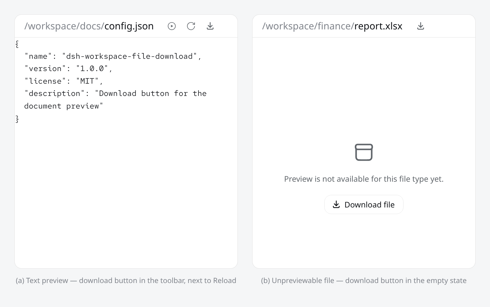
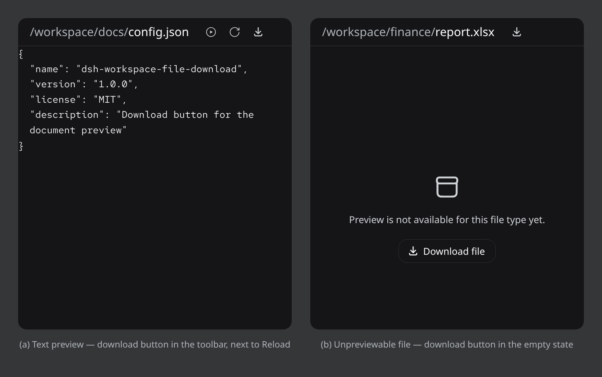

# dsh-workspace-file-download

A small DeepSeek Harness (DSH) Web UI plugin that adds a **download button** to the document preview pane, so you can save a previewed workspace file straight to your computer.

| | |
|---|---|
| **(a) Text preview** — download button in the toolbar, right of *Reload* | **(b) Unpreviewable file** — *Download file* button in the empty state |



*Light theme. The images are illustrations rendered from the real shipped document-preview component (its actual DOM structure, stylesheet, and design-token values) with this plugin's buttons included — not captures of a live session. Your GUI may differ slightly depending on DSH version and theme.*



*Same two placements in the dark theme.*

## What it does

- **Toolbar placement (a)** — a new icon-only button appears in the document-preview header, next to the *Auto refresh* and *Reload* tools. A tooltip and `aria-label` say **Download file**.
- **Unpreviewable files (b)** — when the preview shows *“Preview is not available for this file type yet.”* (binary files such as `.xlsx`, `.pdf`, `.zip`, or files too large to preview), a full **Download file** button is injected into that empty state — exactly the cases where you'd otherwise have no way to get the file out of the GUI.
- **How a download works** — clicking fetches the file from the authenticated `GET /api/file?path=…` endpoint of your DSH Web app (same-origin credentials), receives it as a `Blob`, and hands it to the browser's native save dialog via an object URL. The file is saved under its original base name (e.g. `report.xlsx`). The object URL is revoked shortly after.
- **States** — the button is enabled when a file is previewed, becomes busy (*Downloading…*) while the fetch runs, then returns to idle or shows an error.
- **Localized errors** — failures are reported inline next to the button in your UI language (English and Simplified Chinese are built in):
  - `404` — the file is no longer available at that path
  - `403` — the file cannot be downloaded from this session
  - `413` / too large — *This file is too large to download.* (see note below)
  - network / other — a generic error line
- **Design** — the buttons use the DSH design tokens (`--dsw-alias-*` colors, radii, fonts), so they follow your light/dark theme and match the surrounding preview header. No hard-coded colors, no layout shifts: the toolbar button is the same 28 px size as its neighbors.

## Installing

The plugin is a standard DSH **bundle** (a small npm package plus a Cordis patch that registers it). It targets the `web` client platform and injects into the `@deepseek-ai/dsh-client-ui-sidebar-documentpreview` package.

> **Requires:** a current DSH release that ships the document-preview sidebar plugin (tested with `@deepseek-ai/dsh 0.2.1-rc.2`).

### Option 1 — through your DSH agent (easiest)

Clone the repo, then ask your agent to install it into your current profile, e.g.:

```
Clone https://github.com/pureexe/dsh-workspace-file-download into ~/plugin/
and install it into my current profile.
```

The agent runs the plugin manager's bundle install, which wires the package into your profile's `package.json` and activates the patch. After that, open (or refresh) the Harness Web UI — the buttons are live.

### Option 2 — manually

1. Clone the repository anywhere on disk:

   ```sh
   git clone https://github.com/pureexe/dsh-workspace-file-download.git
   ```

2. In your DSH profile directory (`$DSH_PROFILE_DIR`, e.g. `~/.dsh/profiles/<name>`), edit `package.json`:

   - add to `dependencies`:

     ```json
     "@local/dsh-workspace-file-download": "link:/absolute/path/to/dsh-workspace-file-download"
     ```

   - add `"@local/dsh-workspace-file-download"` to the list under `dsh.profile.bundles`.

   The `@local` scope is intentional: it marks profile-local bundles that are resolved from the profile's own `node_modules`.

3. Install and restart:

   ```sh
   pnpm install   # in the profile directory
   ```

   then restart Harness (or refresh the Web UI — the bundle activates immediately on page load).

To remove the plugin, delete the two `package.json` entries, run `pnpm install` again, and restart.

## Repository layout

| File | Purpose |
|---|---|
| `package.json` | Bundle manifest (`dsh.bundle.patch`, `dsh.client` client declaration with its inject list) |
| `cordis.patch.yml` | Cordis patch that registers the plugin row into the profile composition |
| `index.js` | Host-side loader registration (module entry) |
| `client.js` | Web client code: button components, fetch/object-URL download, state handling, i18n, and the injected CSS |
| `locale/en.json`, `locale/zh.json` | English and Simplified Chinese strings |
| `icon.svg` | Plugin icon |
| `docs/light.png`, `docs/dark.png` | Illustrations used in this README |

## Notes and limitations

- **Size cap.** Files that exceed the harness's preview size limit are the very files that land in the “not available for this file type yet.” state. If such a file is also rejected by the file endpoint with `413`, the download button reports *“This file is too large to download.”* instead of failing silently — a documented behavior, not a bug.
- **Session access.** Downloads go through the same authenticated session as the GUI; the file must exist under a path your session can read.
- **Live-session screenshots.** The images in this README were rendered from the real component/theme assets because no live GUI session was connected when they were produced; treat them as faithful illustrations rather than pixel captures of your own installation.

## License

[MIT](LICENSE) © pureexe
